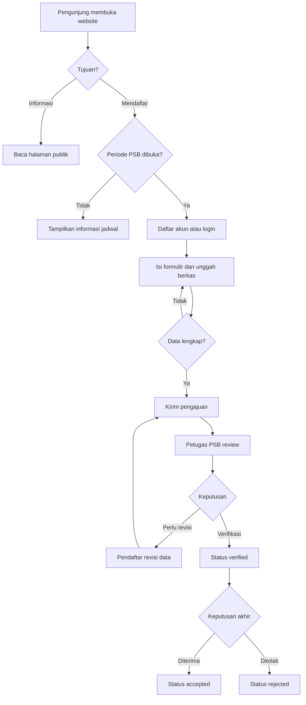

# PRODUCT REQUIREMENTS DOCUMENT (PRD)
## Website Pondok Pesantren Damanhuri Romly

**Versi:** 1.0 — Rancangan awal  
**Tanggal:** 14 November 2026  
**Status:** Draft untuk validasi bersama pihak pesantren  
**Platform:** Aplikasi web responsif  
**Stack utama:** Laravel + Blade + Vite + MySQL 8.x  
**Kategori produk:** Website profil, CMS, dan Pendaftaran Santri Baru (PSB) dasar

> **Asumsi utama:** Nama lembaga mengikuti permintaan pemilik proyek. Alamat resmi, logo, identitas pengasuh, kontak, program, foto, jadwal, biaya, dan SOP pendaftaran **belum diverifikasi**. Semua wajib berupa konten dinamis atau placeholder yang jelas; jangan mengarangnya. Modul PSB adalah usulan pengembangan dan perlu persetujuan pengelola.

## Ringkasan produk

Website ini menjadi pusat informasi resmi Pondok Pesantren Damanhuri Romly. Pengunjung bisa mengenal profil pesantren, membaca informasi pendidikan, berita, kegiatan, dan menghubungi pengelola. Admin dapat memperbarui konten tanpa mengubah kode. Dalam cakupan rilis v1, tersedia PSB dasar agar calon santri/wali dapat mengajukan pendaftaran, melengkapi dokumen, dan memantau status dengan aman. Sistem **bukan** aplikasi akademik atau sistem pembayaran pesantren.

**Keputusan arsitektur penting:** MySQL tidak memiliki fitur Row-Level Security (RLS) native seperti PostgreSQL. Oleh sebab itu, istilah “RLS” dalam proyek ini berarti **isolasi record di tingkat aplikasi** memakai Laravel Policy/Gate, pembatasan query server-side, kontrol otorisasi di route/controller, serta pengujian kebocoran antar akun. Jangan menjualnya sebagai native database RLS. Hak akses MySQL minimum menjadi lapisan tambahan, bukan pengganti otorisasi aplikasi.

---

# 1. GOALS — Tujuan Proyek

## 1.1 Masalah yang ingin diselesaikan

1. Informasi resmi pesantren berpotensi tersebar di berbagai media dan tidak selalu konsisten.
2. Pembaruan berita, pengumuman, dan agenda sulit dikelola jika semua perubahan harus melalui programmer.
3. Pertanyaan tentang program, persyaratan, dan kontak berulang tanpa satu sumber informasi terpusat.
4. Jika pendaftaran dilakukan secara manual, berkas dan progres verifikasi berisiko tidak terdokumentasi dengan baik.
5. Data calon santri dan wali memerlukan pembatasan akses dan penyimpanan yang tidak terbuka ke publik.

Poin-poin tersebut adalah **hipotesis kebutuhan**, bukan hasil observasi lapangan. Konfirmasi dalam wawancara pengelola sebelum mengunci ruang lingkup akhir.

## 1.2 Tujuan bisnis dan pengguna

- Menyediakan profil resmi pesantren yang mudah ditemukan dan dipahami pada ponsel maupun komputer.
- Memungkinkan editor yang berwenang mengelola informasi melalui CMS.
- Menyediakan jalur komunikasi dan pengumuman yang terpusat.
- Memfasilitasi PSB dasar, termasuk penyimpanan berkas privat dan riwayat status.
- Melindungi data calon santri/wali dengan prinsip hak akses minimum (*least privilege*).
- Menyiapkan aplikasi yang dapat diuji, dipelihara, dan dideploy tanpa ketergantungan tidak perlu.

## 1.3 Target pengguna dan peran

| Peran | Kebutuhan utama | Batas hak akses |
|---|---|---|
| Pengunjung | Melihat profil, program, berita, kontak, dan informasi PSB | Konten yang sudah dipublikasikan saja |
| Pendaftar (calon santri/wali) | Membuat pengajuan, unggah berkas, lihat status, revisi saat diminta | Hanya pengajuan dan berkas milik akun sendiri |
| Editor konten | Mengelola halaman, berita, agenda, galeri, dan media publik | Konten; tidak dapat membaca data PSB privat |
| Petugas PSB | Memeriksa pengajuan, memberi catatan, mengubah status | Semua pengajuan PSB sesuai izin; tidak mengubah manajemen user |
| Super admin | Konfigurasi situs, kelola peran, CMS, PSB, audit | Semua fungsi sesuai tugas administratif; tindakan penting dicatat |

**Catatan:** Peran pimpinan *read-only* dapat ditambahkan setelah ada kebutuhan nyata; tidak wajib v1.

## 1.4 Indikator keberhasilan (target awal, divalidasi kemudian)

| Area | Target penerimaan |
|---|---|
| Konten | 100% halaman inti dapat diubah dari CMS atau pengaturan situs |
| Navigasi | Pengunjung dapat menemukan profil, program, berita, kontak, dan PSB maksimal 3 langkah navigasi |
| PSB | Alur akun → formulir → dokumen → kirim → verifikasi → status dapat dituntaskan |
| Keamanan | 0 kasus akses data pendaftar lain dalam tes otorisasi negatif |
| Kualitas | Seluruh skenario kritis lulus pengujian sebelum rilis |
| Responsif | Tidak ada horizontal overflow pada lebar 360, 768, 1024, dan 1440 px |
| Kinerja | Target Lighthouse Performance mobile ≥ 80 pada halaman publik representatif, setelah aset dan hosting final siap |

---

# 2. FITUR — Kebutuhan Fungsional

Prioritas: **P0** = fondasi wajib; **P1** = untuk rilis v1; **P2** = setelah rilis awal. “Selesai” harus dibuktikan melalui kriteria penerimaan, bukan sekadar UI.

## 2.1 Area publik

| ID | Fitur | Prioritas | Kriteria penerimaan minimum |
|---|---|---|---|
| PUB-01 | Beranda | P0 | Hero, profil ringkas, program unggulan, berita terbaru, CTA; semuanya memakai konten yang dapat dikelola |
| PUB-02 | Profil pesantren | P0 | Sejarah, visi-misi, pengasuh/struktur, data umum; tidak ada fakta fiktif |
| PUB-03 | Program pendidikan | P0 | Daftar, detail, ringkasan, gambar opsional; hanya status terbit tampil |
| PUB-04 | Berita & pengumuman | P0 | Daftar, detail, kategori, tanggal, status draft/terbit, slug unik, pagination |
| PUB-05 | Agenda kegiatan | P1 | Daftar, detail, tanggal, lokasi berupa teks, status terbit |
| PUB-06 | Fasilitas & galeri | P1 | Pengelompokan album, gambar, teks alternatif (*alt text*) |
| PUB-07 | FAQ & kontak | P1 | FAQ dinamis, alamat/telepon/WhatsApp dari settings, formulir pesan tervalidasi |
| PUB-08 | SEO & berbagi | P1 | Title, description, canonical, OG, sitemap, robots; halaman privat noindex |
| PUB-09 | Informasi PSB | P1 | Persyaratan, alur, jadwal, tautan daftar dari settings; tidak mengarang periode/biaya |

## 2.2 Autentikasi dan hak akses

| ID | Fitur | Prioritas | Kriteria penerimaan minimum |
|---|---|---|---|
| AUTH-01 | Login/logout | P0 | Login aman, session regenerate, logout invalidasi sesi |
| AUTH-02 | Akun pendaftar | P1 | Register, verifikasi email bila dikonfigurasi, reset password |
| AUTH-03 | Manajemen akun internal | P0 | Hanya super admin dapat membuat/menonaktifkan staf dan mengatur role |
| AUTH-04 | RBAC | P0 | Route, menu, aksi, dan data dibatasi berdasarkan role; menu tersembunyi bukan kontrol keamanan |
| AUTH-05 | Isolasi record (“RLS” aplikasi) | P0 | Pendaftar tidak dapat membaca, mengubah, mengunduh dokumen, atau menebak data akun lain |
| AUTH-06 | Audit trail | P1 | Perubahan peran, publikasi, review PSB, dan penghapusan terekam tanpa password/token |

Tidak ada pendaftaran publik otomatis sebagai super admin atau petugas. Super admin awal dibuat melalui perintah CLI/installer aman, bukan password baku dalam repository.

## 2.3 CMS admin

| ID | Fitur | Prioritas | Kriteria penerimaan minimum |
|---|---|---|---|
| CMS-01 | Dashboard | P0 | Ringkasan jumlah konten terbit/draft, pesan masuk, dan PSB bila diaktifkan |
| CMS-02 | CRUD konten | P0 | Buat, edit, preview, terbitkan, arsipkan halaman/berita/program |
| CMS-03 | Pengelolaan agenda/FAQ | P1 | CRUD, sort order, tampil/sembunyi |
| CMS-04 | Media manager | P0 | Upload tervalidasi, alt text, preview, hapus dengan pemeriksaan referensi |
| CMS-05 | Pengaturan situs | P0 | Nama, deskripsi, logo, favicon, kontak, medsos, alamat, jam layanan, tombol CTA |
| CMS-06 | Kotak pesan | P1 | Lihat pesan, tandai ditangani, hapus sesuai kebijakan retensi |
| CMS-07 | Pencarian/filter | P1 | Cari berdasarkan judul/status/tanggal, pagination di server |

## 2.4 Pendaftaran Santri Baru (PSB) dasar

Modul PSB **memerlukan validasi SOP pesantren**, termasuk siapa yang mendaftar (wali/calon santri), syarat dokumen, dan proses keputusan. Pada rancangan awal, akun “pendaftar” bertindak sebagai pemilik pengajuan.

| ID | Fitur | Prioritas | Kriteria penerimaan minimum |
|---|---|---|---|
| PSB-01 | Periode PSB | P1 | Admin dapat buka/tutup pendaftaran dan memperbarui penjelasan persyaratan |
| PSB-02 | Formulir & draft | P1 | Data minimum, validasi server-side, draft dapat disimpan pemilik |
| PSB-03 | Upload berkas privat | P1 | File tersimpan private, aturan MIME/ukuran, hanya pemilik/petugas sah yang mengakses |
| PSB-04 | Submit pendaftaran | P1 | Cek kelengkapan, nomor pendaftaran unik, status `submitted` |
| PSB-05 | Review petugas | P1 | Status `needs_revision`, `verified`, `accepted`, `rejected` dan catatan alasan |
| PSB-06 | Revisi pemilik | P1 | Hanya ketika `needs_revision`, edit item yang diizinkan dan submit ulang |
| PSB-07 | Pelacakan status | P1 | Dashboard akun menampilkan progres dan histori milik sendiri |
| PSB-08 | Notifikasi | P2 | Email perubahan status; gagal kirim tidak menggagalkan transaksi utama |

**Status yang disarankan:** `draft` → `submitted` → (`needs_revision` → `submitted`) → `verified` → (`accepted` atau `rejected`). Perubahan status hanya melalui transisi yang sah; penerimaan akhir hanya oleh petugas berwenang. Tidak ada pembayaran online dalam v1.

**Prinsip data minimum:** Hindari NIK, nomor KK, dokumen identitas detail, data kesehatan, dan atribut sensitif lain pada versi awal kecuali diwajibkan secara administratif dan disetujui dalam SOP serta kebijakan privasi. Untuk pendaftar usia anak, alur dan pemberitahuan pemrosesan data diarahkan kepada wali/orang tua yang berwenang.

## 2.5 Matriks akses ringkas

| Tindakan | Pengunjung | Pendaftar | Editor | Petugas PSB | Super admin |
|---|---|---|---|---|---|
| Baca konten terbit | Ya | Ya | Ya | Ya | Ya |
| Kelola konten | Tidak | Tidak | Ya | Tidak | Ya |
| Buat/ubah pengajuan sendiri | Tidak | Ya* | Tidak | Tidak | Ya** |
| Baca berkas pengajuan lain | Tidak | Tidak | Tidak | Ya | Ya |
| Review & ubah status PSB | Tidak | Tidak | Tidak | Ya | Ya |
| Kelola pengguna/role | Tidak | Tidak | Tidak | Tidak | Ya |
| Baca audit log | Tidak | Tidak | Tidak | Tidak | Ya |

`*` Sesuai periode/status yang diizinkan. `**` Hanya untuk dukungan administratif yang memiliki jejak audit; secara default super admin tidak mengatasnamakan pendaftar tanpa SOP.

---

# 3. USER FLOW — Alur Pengguna

## 3.1 Pengunjung mencari informasi

**Beranda → pilih Profil/Program/Berita → detail informasi → Kontak atau Halaman PSB.**

- Input: klik navigasi, pencarian berita jika tersedia.
- Keputusan: konten `published`? Jika tidak, hasil tidak tersedia untuk publik.
- Output: informasi resmi yang diperbarui admin.

## 3.2 Editor memublikasikan berita

**Login → dashboard CMS → buat berita → isi judul, ringkasan, isi, kategori & media → simpan draft → preview → publish → tampil di publik.**

- Jika validasi gagal, kembali ke form dengan pesan jelas.
- Slug harus unik; publik hanya dapat membuka status terbit.
- Perubahan penerbitan dicatat ke `audit_logs`.

## 3.3 Pendaftar mengirim pengajuan

**Halaman PSB → cek periode → daftar akun/login → isi profil & data calon santri → unggah dokumen yang diwajibkan → simpan draft → cek ringkasan → kirim pengajuan → nomor pendaftaran dan status `submitted`.**

- Jika periode ditutup: tampilkan informasi resmi; tidak boleh submit baru.
- Jika ada berkas yang belum lengkap: tampilkan checklist kesalahan; jangan mengubah status.
- Dokumen tidak dipublikasikan atau dilayani lewat URL storage publik.

## 3.4 Petugas memverifikasi dan pendaftar merevisi

**Petugas login → daftar pengajuan → buka detail privat → cek berkas → keputusan:**

- **Perlu revisi:** set `needs_revision` + alasan; pendaftar hanya dapat mengubah miliknya; submit ulang.
- **Terverifikasi:** set `verified`; lanjut keputusan administrasi `accepted`/`rejected` sesuai SOP.
- **Tidak berizin:** akses ditolak HTTP 403 atau 404 tanpa membuka konten privat.

Semua perubahan status harus menyimpan petugas, waktu, dari-status, ke-status, dan catatan yang layak disimpan. Tidak boleh mengirim data pribadi ke log aplikasi.

## 3.5 Diagram alur ringkas



---

# 4. UI/UX — Desain Pengalaman Pengguna

## 4.1 Prinsip visual

- **Karakter:** Islami, ramah, tepercaya, bersih, modern, dan mudah dibaca; tidak berlebihan dalam ornamen.
- **Palet usulan (bukan warna resmi):** hijau tua `#14532D`, hijau menengah `#287D52`, krem `#FAF8F0`, emas lembut `#C6A55C`, teks gelap `#1F2937`.
- **Tipografi:** font web legibel; heading tegas, body minimum sekitar 16 px untuk konten utama.
- **Komponen:** header sticky secukupnya, cards radius konsisten, tombol primer jelas, icon bukan satu-satunya penanda aksi.
- **Identitas:** logo/foto asli diganti melalui CMS; jangan memasang logo dan foto institusi yang tidak tervalidasi.
- **Aksesibilitas:** target WCAG 2.2 AA; fokus keyboard jelas, label form, alt text, kontras memadai, status tidak hanya ditunjukkan dengan warna.

## 4.2 Sitemap publik

```
/
├── profil
│   ├── sejarah
│   ├── visi-misi
│   └── pengasuh-struktur
├── program
│   └── {slug}
├── berita
│   └── {slug}
├── agenda
├── fasilitas
├── galeri
├── psb
├── faq
├── kontak
├── kebijakan-privasi
└── login / daftar (untuk pendaftar)
```

## 4.3 Struktur dashboard

- Sidebar desktop / drawer mobile: Dashboard, Konten, Berita, Program, Agenda, Galeri, Media, Pesan, PSB (khusus petugas), Pengguna (super admin), Pengaturan.
- Header: breadcrumb, pencarian kontekstual bila diperlukan, profil, keluar.
- List data: search, filter status, pagination, aksi lihat/edit dalam batas izin.
- Form: label tetap terlihat, validasi per-field, indikator wajib, status menyimpan/berhasil/gagal.
- Halaman PSB pendaftar: progress stepper, checklist berkas, tombol `Simpan Draft` dan `Kirim Pendaftaran` terpisah.

## 4.4 Responsif dan keadaan UI

- Mobile first; uji pada 360, 390, 768, 1024, dan 1440 px.
- Tidak boleh ada tombol di luar viewport atau tabel terpotong tanpa alternatif scroll yang jelas.
- Sediakan **loading, empty, success, error, 403, 404, dan session expired states**.
- Gunakan skeleton/loading sederhana, tidak mengandalkan animasi berat.
- Seluruh halaman publik berbahasa Indonesia; dukungan bahasa Arab/Inggris adalah fase selanjutnya.

## 4.5 Rancangan halaman utama

**Beranda:** topbar kontak (jika ada), navbar, hero dengan CTA, ringkasan pesantren, program, fasilitas pilihan, berita terbaru, ajakan PSB ketika dibuka, footer lengkap.  
**Detail berita:** judul, kategori, tanggal, gambar utama (opsional), isi, berita terkait, metadata SEO.  
**Halaman PSB:** syarat, alur langkah, dokumen, tanggal bila tervalidasi, CTA akun, FAQ.  
**Dashboard admin:** statistik sederhana, tindakan cepat, daftar aktivitas terbaru tanpa menampilkan data sensitif yang tidak berizin.

---

# 5. DATABASE OVERVIEW — Rancangan Basis Data

## 5.1 Prinsip penyimpanan

- MySQL 8.x, InnoDB, `utf8mb4`, foreign key aktif, unique/index pada pencarian rutin.
- Semua perubahan skema melalui Laravel migrations; data contoh melalui seeders/factories, tidak memakai data pribadi nyata.
- Kolom `created_at`, `updated_at`; soft delete hanya untuk entitas yang perlu dipulihkan dan dilacak.
- Gunakan transaksi DB untuk submit PSB dan perubahan status + histori.
- `registration_number` bukan token otorisasi; akses tetap berdasarkan user login dan Policy.
- Media publik dipisahkan dari dokumen PSB privat secara fisik/logis.

## 5.2 Daftar tabel utama

| Tabel | Fungsi | Kolom penting (ringkas) |
|---|---|---|
| `users` | Akun staf/pendaftar | `id`, `name`, `email` unik, `password`, `role`, `is_active`, `email_verified_at` |
| `pages` | Halaman statis dinamis | `id`, `title`, `slug` unik, `body`, `status`, `published_at`, `author_id` |
| `post_categories` | Kategori berita | `id`, `name`, `slug` unik |
| `posts` | Berita/pengumuman | `id`, `category_id`, `author_id`, `title`, `slug`, `summary`, `body`, `status`, `featured_media_id`, `published_at` |
| `programs` | Program pendidikan | `id`, `name`, `slug`, `summary`, `body`, `status`, `sort_order` |
| `staff_profiles` | Profil pengasuh/struktur publik | `id`, `name`, `position`, `description`, `photo_media_id`, `is_published`, `sort_order` |
| `facilities` | Fasilitas | `id`, `name`, `description`, `photo_media_id`, `is_published` |
| `events` | Agenda | `id`, `title`, `slug`, `description`, `start_at`, `end_at`, `location_text`, `status` |
| `galleries` | Album galeri | `id`, `title`, `slug`, `description`, `status` |
| `gallery_media` | Penghubung album-media | `id`, `gallery_id`, `media_file_id`, `sort_order` |
| `media_files` | Metadata file publik | `id`, `uploaded_by`, `disk`, `path`, `original_name`, `mime_type`, `size_bytes`, `alt_text`, `visibility` |
| `faqs` | Tanya jawab | `id`, `question`, `answer`, `is_published`, `sort_order` |
| `contact_messages` | Pesan pengunjung | `id`, `name`, `contact`, `subject`, `message`, `status` |
| `registration_periods` | Periode PSB | `id`, `name`, `opens_at`, `closes_at`, `is_active`, `requirements_text` |
| `registrations` | Pengajuan calon santri | `id`, `user_id`, `registration_period_id`, `registration_number`, `student_name`, `guardian_name`, `guardian_contact`, `status`, `submitted_at` |
| `registration_documents` | Berkas privat pengajuan | `id`, `registration_id`, `document_type`, `disk`, `path`, `mime_type`, `size_bytes`, `uploaded_at` |
| `registration_status_histories` | Jejak keputusan | `id`, `registration_id`, `actor_id`, `from_status`, `to_status`, `note`, `created_at` |
| `site_settings` | Konfigurasi website | `id`, `setting_key` unik, `setting_value`, `type` |
| `audit_logs` | Jejak tindakan admin | `id`, `actor_id`, `action`, `subject_type`, `subject_id`, `metadata_json`, `created_at` |

**Detail skema harus divalidasi saat implementasi.** Contoh: `guardian_contact` sebaiknya dipertimbangkan untuk enkripsi aplikasi jika tidak perlu di-query secara langsung. Jangan mencatat password, session ID, kode verifikasi, isi berkas, atau token reset dalam `audit_logs`.

## 5.3 Relasi inti

- `users (1) — (N) posts/pages/media_files` melalui `author_id` atau `uploaded_by`.
- `post_categories (1) — (N) posts`.
- `galleries (N) — (N) media_files` melalui `gallery_media`.
- `users (1) — (N) registrations` **pemilik data**.
- `registration_periods (1) — (N) registrations`.
- `registrations (1) — (N) registration_documents`.
- `registrations (1) — (N) registration_status_histories`.
- `users (1) — (N) registration_status_histories` sebagai `actor_id`.

## 5.4 Indeks dan validasi basis data

- `users.email` unique; `pages.slug`, `posts.slug`, `programs.slug` unique.
- `registrations.registration_number` unique.
- Indeks komposit `registrations(user_id, status)` dan `(registration_period_id, status)`.
- Indeks `posts(status, published_at)` serta `events(status, start_at)`.
- Constraint konsisten untuk status dan non-null kritis; validasi Laravel tetap diperlukan.
- Tidak boleh menyimpan path file privat dalam halaman publik, API publik, atau atribut HTML yang tidak diperlukan.

## 5.5 Model isolasi record (“RLS” tingkat aplikasi)

1. **Pemilik data:** `registrations.user_id` ditetapkan dari `auth()->id()` di server; jangan percaya `user_id` dari form atau query string.
2. **Policy:** `RegistrationPolicy` dan `RegistrationDocumentPolicy` memeriksa pemilik/peran pada seluruh operasi `view`, `update`, `submit`, `download`, dan `delete` yang diizinkan.
3. **Query scoping:** daftar pendaftar wajib difilter `where('user_id', auth()->id())`; staf PSB mendapat query terpisah sesuai role. Bukan hanya menyaring tabel pada frontend.
4. **Route model binding:** detail berdasarkan ID/ULID tidak otomatis boleh diakses; selalu lakukan otorisasi objek.
5. **Berkas privat:** controller memeriksa policy **sebelum** membaca file; file bukan URL publik.
6. **Database:** kredensial aplikasi dengan hak minimal; migration/admin menggunakan kredensial terpisah saat deployment bila memungkinkan.
7. **Pengujian negatif:** akun A tidak bisa membaca/mengubah/mengunduh pendaftaran/dokumen akun B, termasuk lewat ID dan endpoint yang ditebak.

`403` sesuai untuk operasi tanpa izin. `404` dapat dipilih untuk menyamarkan keberadaan objek privat. Pilih pola yang konsisten dan uji kebocoran informasi.

---

# 6. TECHNICAL REQUIREMENTS — Kebutuhan Teknis

## 6.1 Stack dan arsitektur

| Lapisan | Rekomendasi |
|---|---|
| Backend | Laravel versi stabil yang kompatibel dengan proyek; untuk proyek baru gunakan versi stabil saat implementasi |
| Frontend | Blade + Tailwind CSS + JavaScript seperlunya, dibundel melalui Vite |
| Database | MySQL 8.x, InnoDB, utf8mb4 |
| Autentikasi | Sistem auth resmi Laravel/starter kit yang kompatibel; session-based untuk web |
| Hak akses | Middleware auth/role, Policies/Gates, query scoping, validasi Form Request |
| Storage publik | Laravel `public` disk untuk foto dan media yang sudah disetujui |
| Storage privat | Laravel private/local disk atau private object storage untuk dokumen PSB |
| Pengujian | PHPUnit/Pest + Feature Tests + pengujian UI responsif |
| Hosting | PHP-compatible server, HTTPS, cron untuk scheduler jika dipakai, queue worker bila diperlukan |

**Alasan pilihan:** Blade cocok untuk website informasi dan SEO, lebih sederhana daripada SPA penuh. Jika proyek yang ada memakai Livewire/Inertia, audit terlebih dahulu dan pertahankan fondasi yang sudah berjalan bila sesuai kebutuhan. Jangan melakukan pergantian stack tanpa persetujuan.

## 6.2 Arsitektur logis

```
Browser / Mobile
      |
    HTTPS
      |
Laravel Web Routes + Session + CSRF
      |
Middleware (auth, verified, role, rate limit)
      |
Controllers → Form Requests → Policies → Services
      |
Eloquent Models → MySQL 8.x
      |
Storage Public / Storage Private
```

## 6.3 Aturan keamanan wajib

- HTTPS di produksi; `APP_DEBUG=false`; `.env` tidak dikomit; `APP_KEY` aman.
- Password hash bawaan Laravel, reset token aman, login rate limit, session regen/logout invalidasi.
- Form write memakai CSRF; validasi di server; output HTML di-escape default Blade; rich text disanitasi memakai allowlist yang tepercaya.
- Authorization di backend untuk setiap aksi, termasuk download, preview, export dan AJAX.
- Validasi file berdasar isi/MIME dan ekstensi; batas awal gambar 5 MB, PDF 10 MB; nama file acak; whitelist tipe; larang file executable.
- Pisahkan file publik dan privat; tidak menyimpan dokumen PSB di `storage/app/public`.
- Cegah IDOR, mass assignment, SQL injection; query parameterized; hanya kolom yang diizinkan dapat diperbarui.
- Rate limit untuk login, pendaftaran, dan form kontak; proteksi spam (honeypot/captcha bila diperlukan).
- Backup terenkripsi dan diuji pemulihannya; retensi berkas & penghapusan harus disepakati pengelola.
- Audit tindakan sensitif tanpa memasukkan password, token, atau data pribadi berlebihan.
- Pisahkan hak database aplikasi dan kredensial administrasi migrasi bila lingkungan mendukung.
- Dokumen dan foto anak/santri **jangan dipublikasikan tanpa persetujuan yang sesuai**; siapkan kebijakan privasi dan pemberitahuan pemrosesan data.

## 6.4 Non-functional requirements

| Aspek | Kebutuhan |
|---|---|
| Aksesibilitas | Navigasi keyboard, kontras layak, pesan validasi jelas; target WCAG 2.2 AA |
| Performa | Kompresi gambar, lazy loading, caching konten publik, pagination, hindari N+1 |
| SEO | Metadata dinamis, robots, sitemap, URL slug, canonical, struktur heading |
| Ketersediaan | Halaman 404/500 yang ramah; logging error tanpa data sensitif; backup DB & file |
| Keamanan | Uji IDOR, XSS, CSRF, akses tanpa login, upload berbahaya, otorisasi role |
| Maintainability | Struktur code konsisten, reusable components, migration dan seeder terkontrol |
| Observability | Log aplikasi berlevel, monitoring error sederhana, audit tindakan staf |
| Privasi | Data minimum, notifikasi privasi, kontrol akses, SOP retensi dan hapus data |

## 6.5 Rencana pengujian dan kriteria selesai

**Pengujian wajib:**

1. Visitor hanya melihat konten `published`, bukan `draft`/`archived`.
2. Editor tidak bisa mengakses route PSB dan manajemen user meski mengganti URL.
3. Petugas PSB tidak bisa mengubah pengaturan user atau konten CMS.
4. Pendaftar A tidak bisa melihat/mengubah/mengunduh pengajuan B.
5. Upload berekstensi palsu / MIME tidak valid ditolak.
6. Submit PSB tidak lolos bila periode ditutup atau berkas wajib belum lengkap.
7. Transisi status ilegal ditolak; transisi legal menciptakan histori.
8. Berita yang dipublikasikan muncul; berita draft tidak terindeks pada sitemap.
9. Logout membatalkan akses ke halaman privat.
10. Unit/feature tests lulus dan `npm run build` berhasil.

**Definition of Done (DoD):** fitur memenuhi acceptance criteria, seluruh tes relevan lulus, otorisasi diuji positif dan negatif, input tervalidasi, ada kondisi kosong/error, tampilan responsif, dan dokumentasi setup diperbarui.

## 6.6 Konfigurasi dan deployment

- Gunakan `.env.example` untuk daftar variabel tanpa rahasia: `APP_NAME`, `APP_URL`, `DB_*`, `MAIL_*`, `FILESYSTEM_DISK`, dan pengaturan queue sesuai kebutuhan.
- Terapkan migration dengan backup terlebih dahulu di lingkungan aktif. Hindari `migrate:fresh` pada database berisi data.
- Pipeline: `composer install` → install frontend deps (`npm ci` jika lockfile ada) → build (`npm run build`) → migrate aman → cache konfigurasi/route/view sesuai versi → health check.
- Scheduler/queue hanya diwajibkan jika fitur notifikasi/latar belakang memang dipakai; sesuaikan dengan kemampuan hosting.
- Siapkan dokumentasi pemulihan, rotasi kredensial, dan admin onboarding.

## 6.7 Referensi implementasi

- Laravel Authorization: https://laravel.com/docs/13.x/authorization
- Laravel Filesystem: https://laravel.com/docs/13.x/filesystem
- Laravel Vite: https://laravel.com/docs/13.x/vite
- Penjelasan batas native RLS MySQL: https://aws.amazon.com/blogs/database/implement-row-level-security-in-amazon-aurora-mysql-and-amazon-rds-for-mysql/

Versi tautan Laravel dapat disesuaikan dengan versi yang benar-benar dipakai proyek.

---

# 7. SCOPE PROJECT — Ruang Lingkup dan Tahapan

## 7.1 Masuk cakupan rilis v1

- Website informasi publik dengan halaman profil, program, berita/pengumuman, agenda, galeri, FAQ, kontak.
- Admin CMS untuk konten dan pengaturan identitas situs.
- Login, logout, reset password, pengelolaan user internal, RBAC.
- PSB dasar: periode, akun pendaftar, formulir, upload privat, tracking status, review dan revisi.
- Audit aktivitas sensitif, validasi keamanan, responsive UI, SEO dasar, panduan instalasi dan pengujian.

## 7.2 Tidak masuk cakupan rilis v1

- Sistem informasi akademik lengkap: nilai, rapor, absensi santri, jadwal mengajar, asrama, hafalan.
- Pembayaran SPP/PSB, gateway pembayaran, akuntansi, kuitansi otomatis.
- Aplikasi mobile native, chatbot AI, presensi wajah, integrasi CCTV.
- Integrasi WhatsApp otomatis berbayar, e-learning, portal alumni, multi-pesantren.
- RLS native MySQL (tidak tersedia); jika native database RLS adalah persyaratan absolut, evaluasi penggunaan PostgreSQL dan revisi PRD.
- Pengumpulan data identitas berisiko tinggi sebelum disetujui SOP dan kebijakan privasi.

## 7.3 Tahapan implementasi untuk Antigravity

| Fase | Fokus | Output & gerbang kualitas |
|---|---|---|
| 0 — Audit | Periksa repo, versi, routes, database, auth, assets | Laporan kondisi awal, matriks gap, rencana perubahan; **jangan hapus kode** |
| 1 — Fondasi | MySQL, migration, auth, role, policy, layout UI | Login aman, seed staf pertama, tes RBAC/IDOR awal |
| 2 — Publik | Beranda, profil, program, berita, kontak, SEO | Halaman responsif, konten demo ditandai, tes published/draft |
| 3 — CMS | CRUD, media, galeri, FAQ, agenda, settings | Editor mengelola tanpa akses PSB; upload publik aman |
| 4 — PSB | Akun pendaftar, periode, form, dokumen, review | End-to-end PSB, file privat, negative authorization tests |
| 5 — QA & rilis | UAT, accessibility, security, build, backup, deployment | Tes lulus, dokumentasi, checklist produksi, persetujuan pengelola |

Urutan dapat diubah setelah audit repo, tetapi **keamanan data harus disiapkan sebelum PSB dibuka kepada publik**.

## 7.4 Risiko dan mitigasi

| Risiko | Mitigasi |
|---|---|
| Konten/fakta pesantren belum valid | Simpan sebagai draft/placeholder; minta persetujuan institusi sebelum rilis |
| Kebocoran data pendaftar | Policy + query scoping + private storage + tes lintas akun |
| SOP PSB belum jelas | Validasi status, field, persyaratan, dan siapa yang mengesahkan sebelum fase 4 |
| Hosting tanpa persistent storage | Gunakan object storage kompatibel S3 atau volume persisten; jangan simpan berkas ke disk ephemeral |
| Migrasi merusak data lama | Backup, audit skema, migration non-destruktif, staging |
| Konten/media berat | Optimasi gambar, pagination, caching dan lazy load |

## 7.5 Keputusan terbuka yang perlu divalidasi

1. Nama resmi lembaga, logo, alamat lengkap, lokasi peta, kontak, dan akun media sosial.
2. Program pendidikan, nama pengasuh, struktur organisasi, serta izin penggunaan foto.
3. Apakah website benar-benar memerlukan PSB online pada rilis pertama?
4. SOP PSB: jadwal/periode, formulir minimum, syarat berkas, status akhir, petugas pengesah.
5. Host/domain, layanan email, kapasitas storage, jadwal backup, dan pemegang akses produksi.
6. Masa retensi, prosedur penghapusan data pendaftar, dan persetujuan wali.
7. Siapa yang boleh memublikasikan konten: editor langsung atau perlu persetujuan super admin?

## 7.6 Acceptance checklist final

- [ ] Informasi identitas pesantren sudah diverifikasi pengelola.
- [ ] Semua halaman inti publik berjalan dan responsif.
- [ ] Draft tidak dapat diakses pengunjung.
- [ ] Super admin dapat mengelola staff dan pengaturan situs.
- [ ] Editor hanya dapat mengelola modul konten.
- [ ] Petugas PSB hanya dapat mengakses data PSB sesuai peran.
- [ ] Pendaftar hanya dapat melihat data dan dokumen sendiri.
- [ ] Upload privat tidak dapat diakses melalui URL publik.
- [ ] Skenario PSB lengkap lulus (jika PSB diaktifkan).
- [ ] Semua formulir memiliki validasi dan penanganan error.
- [ ] Tes backend lulus; build Vite lulus; tidak ada error kritis.
- [ ] Backup & prosedur pemulihan didokumentasikan.
- [ ] Pengelola menyetujui konten, kebijakan privasi, dan deployment.

---

**Dokumen ini adalah baseline teknis/produk v1.0, bukan hasil audit sistem yang sudah ada.** Jadikan PRD ini sumber kebenaran untuk Antigravity, tetapi finalkan keputusan terbuka bersama pihak Pondok Pesantren Damanhuri Romly sebelum aplikasi digunakan oleh masyarakat.
